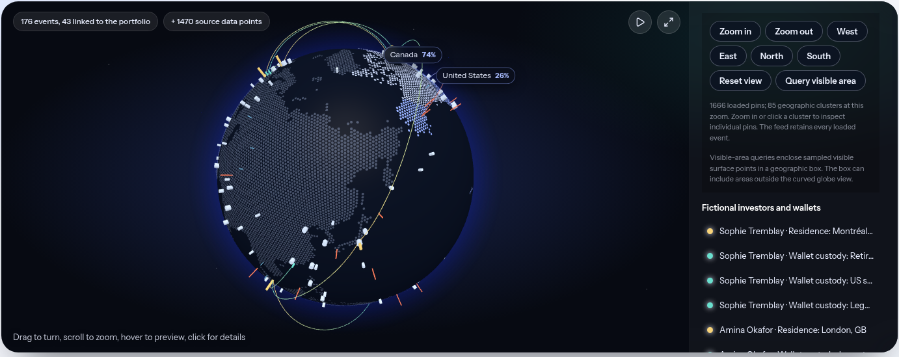
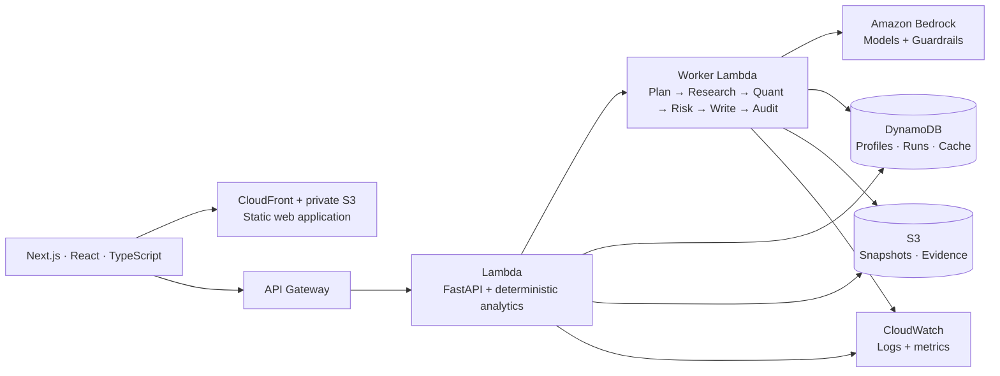

# Aplomb

**Evidence before conviction.**

Aplomb turns an investment idea into a decision you can inspect: what changes in the portfolio, which personal rules it meets, and what evidence supports the explanation. Six specialist roles combine portfolio calculations, research and an audited brief in an English/French workspace.

Built for **AlphaForge AI · Datathon 2026 — National Bank × AWS × PolyFinances**.

**[Open the app](https://d1r325uzu5fe7x.cloudfront.net)** · **[Watch the demo](docs/deliverables/demo/aplomb-live-subtitled.webm)** · **[One-pager](docs/deliverables/one-pager.pdf)** · **[Technical report](docs/deliverables/technical.pdf)** · **[Demo walkthrough](docs/deliverables/demo.md)**



*World Explorer, captured from the live application. Explore a location, inspect its sources, and connect it to the holdings worth investigating.*

## One idea. Three different decisions.

“Add Tesla” means something different for Robert and Amira. Aplomb starts with the investor's goals, horizon, cash needs, holdings and rules, then computes the consequences of the proposed move.

| Investor | Proposed move | What Aplomb finds |
|---|---|---|
| **Robert** | Add 25 percentage points of TSLA | **6 rule conflicts.** The first-conflict boundary is **6 points**. |
| **Amira** | Add 25 percentage points of TSLA | **3 rule conflicts.** The first-conflict boundary is **11 points**. |
| **Mateo** | Add 10 percentage points of CNQ.TO | **His Energy exclusion conflicts**, even though eight financial checks pass. |

These reproducible examples use the full starter-data window, CAD and proportional funding. A size is an addition in portfolio percentage points; the boundary is the last tested size before the first rule conflict. [Calculations and reference results →](contracts/controls.md)

Open **Decide**, select Robert, test TSLA at 25 points, and inspect a highlighted figure. Switch to Amira to see the same idea evaluated against a different plan.

## From knowing yourself to testing a decision

| Workspace | What you can do |
|---|---|
| **Investor Lab** | Make choices at three masked historical checkpoints, consult dated evidence, and explain what would make you reconsider. Review and explicitly confirm the resulting profile settings and investment playbook. |
| **Portfolio** | Bring together accounts, holdings, cash, goals and spending needs. Inspect allocation, concentration, historical risk and a joint plan for competing goals. |
| **Decide** | Test a position using cash, proportional sales, selected holdings or new money. Compare before and after, see each personal rule, and explore the size before the first conflict. |
| **Strategies** | Simulate calendar or band rebalancing, recurring contributions and drawdown guards against a baseline, with transaction costs and the next action visible. |
| **Replay** | Revisit a historical decision with an as-of date, then reveal what followed while preserving the original evidence and decision record. |
| **World Explorer** | Navigate a 3D globe of dated events, hazards and source observations. Inspect countries and portfolio geography to choose what to research next. |
| **Evidence & System** | Open the facts behind a brief, follow its source trail, inspect the agent timeline, and see model usage, timing and audit results. |

The interface supports **English and French**, responsive layouts, guided tours and movable dashboard widgets.

## How a brief earns its conclusions

Aplomb separates calculation, interpretation and verification. The language model chooses useful analyses and explains the results; the quant engine and personal rules determine the numbers and verdicts.

| Role | Responsibility |
|---|---|
| **Planner** | Structure the request, resolve missing details and select analyses. |
| **Researcher** | Gather dated evidence from permitted sources and retain source references. |
| **Quant Engine** | Compute returns, volatility, drawdowns, stress, concentration, correlations and portfolio scenarios in Python. |
| **Risk Officer** | Evaluate the scenario against the investor's explicit rules and funding constraints. |
| **Writer** | Produce the English or French brief using recorded facts and evidence references. |
| **Auditor** | Check the brief against its supporting records before completion. |

The Planner, Researcher, Writer and Auditor use **Strands Agents and Amazon Bedrock**. The Quant Engine and Risk Officer execute deterministic code. Within fixed run budgets, the workflow can revisit its analysis and rewrite a brief after an audit objection.

Every displayed fact can carry its **method, inputs, period, currency, source rows and data version**. Fourteen audit checks validate references, numerical claims, comparisons, quotations and time availability. The final record includes a SHA-256 hash of its facts and evidence so later changes can be detected.

The built-in **Audit test** deliberately introduces an incorrect number, comparison or causal claim and sends it through the same verification path. Judges can inspect the failure and its supporting trace directly.

## Built on AWS



The API serves interactive calculations while the asynchronous worker handles agent runs. Durable checkpoints support progress reporting and recovery; conditional writes protect session ownership and concurrent edits. AWS CDK defines the infrastructure, and GitHub Actions verifies changes and publishes the frontend through OIDC.

[Architecture and deployment →](docs/AWS-ARCHITECTURE.md) · [API contracts →](contracts/api.md) · [Agent tools →](contracts/tools.md)

## Data you can trace

The repository pins its active snapshot to **`snap-20261115-globalfx`**. Manifests record the source, coverage, processing and hashes needed to reproduce it.

| Coverage | Included data |
|---|---|
| **31 investable assets** | 10 Canadian equities, 10 US equities, 9 ETFs, Bitcoin and Ether. |
| **40,049 daily price rows** | November 12, 2021–November 12, 2026, with 658 corporate-action records. |
| **Currency and macro context** | Bank of Canada FX and rates, FRED series, Statistics Canada release dates and Wikimedia attention. |
| **751 dated world events** | Official events and earthquake records, with additional hazard and provider observations. |
| **217 countries** | World Bank country indicators for geographic context. |
| **243 source-directory entries** | A searchable research catalogue with source descriptions and access details. |

Prices originate from the organizers' Yahoo Finance/yfinance starter dataset. The source directory describes research sources; each analysis records which evidence it actually used. Dataset passports retain attribution, methodology and licensing information alongside the data.

[Data sources →](data/SOURCES.md) · [Snapshot specification →](data/SPEC.md) · [Active manifest →](data/manifests/active.json)

## Run locally

Requirements: **Python 3.12**, **[uv](https://docs.astral.sh/uv/)** and **Node.js 22.19+**.

```bash
uv sync --locked
npm ci
npm --prefix infra ci
```

Run the current source locally to explore the latest Investor Lab and playbook additions. Start the API and web app in separate terminals:

```bash
# Terminal 1 — http://localhost:8000
npm run dev:api
```

```bash
# Terminal 2 — http://localhost:3000
npm run dev:web
```

The API materializes and verifies the pinned data snapshot automatically. Portfolio analytics, rule checks, strategies and the world explorer work locally with that data.

For agent runs and free-text parsing, configure AWS credentials with Bedrock access and set `APLOMB_MODEL_STRONG` and `APLOMB_MODEL_FAST`. Research also uses `APLOMB_SOURCE_USER_AGENT` with a contact URL or email. The development launcher reads `APLOMB_*` settings from a local `.env`; [.env.example](.env.example) documents the options.

To run the local interface against the hosted API, use `npm run dev:web:aws`.

## Verify the build

```bash
npm run check
npm run build:web
```

The verification gate checks generated contracts, Python lint and tests, TypeScript, web tests, specification links, and infrastructure assertions with CDK synthesis. Tests cover the reference portfolio calculations, investor-specific rules, agent verification, historical evidence gates, session isolation and Investor Lab confirmation.

## Explore the repository

| Path | Contents |
|---|---|
| [`backend/aplomb/`](backend/aplomb/) | FastAPI, agent workflow, quant engine, rules, Investor Lab, evidence ledger and world data. |
| [`web/`](web/) | Next.js application, feature workspaces, bilingual copy and typed API client. |
| [`contracts/`](contracts/) | Shared API schemas, generated types, tool definitions and numerical controls. |
| [`data/`](data/) | Snapshot manifests, source attribution and data specifications. |
| [`infra/`](infra/) | AWS CDK stack, packaging and release evidence. |
| [`scripts/`](scripts/) | Local development, ingestion, generation and verification tools. |
| [`docs/deliverables/`](docs/deliverables/) | Demo recording, walkthrough, one-pager and technical report. |
| [`Datathon2026/`](Datathon2026/) | Official case, presentation and starter dataset. |

Aplomb is an investment simulation for fictional profiles.
