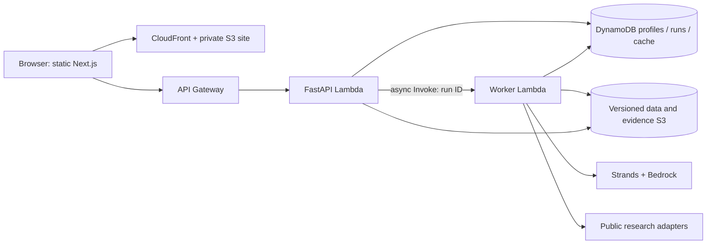

# 03 — Architecture and integration boundaries

## Runtime

One backend codebase, two Lambda entry points: HTTP API and run worker. This preserves D-05's single FastAPI application while making D-06 genuinely asynchronous. The HTTP process persists a queued run and invokes the worker with an ID; it never relies on an in-process background task surviving the response. Lambda async delivery may retry; claims and writes must be idempotent. See [AWS invocation behavior](https://docs.aws.amazon.com/lambda/latest/dg/invocation-async-error-handling.html).

## Module dependency direction

`contracts` has no product dependencies. `datastore` implements versioned/gated reads. `quant` consumes gated series. `rules` consumes snapshots/metrics/evidence. `optimizer` uses quant and rules. `ledger` validates references and explanation tokens. `profiles` coordinates stored profiles with derivation. `agents` composes services; `api` adapts HTTP and repositories. Quant/rules must not import API, agents or AWS SDKs. Dependency injection supplies persistence and transport implementations.

See per-module [backend specs](../backend/SPEC.md), [data](../data/SPEC.md), [infrastructure](../infra/SPEC.md) and [web](../web/SPEC.md). Public JSON types are defined once in [schemas](../contracts/schemas.md); HTTP routing in [API contracts](../contracts/api.md).

## State and consistency

At run creation persist an immutable effective-profile snapshot and version, selected snapshot manifest, input, as-of cutoff, flags and limits. Worker retries use those pinned values, never whatever the profile or data happens to be later. Cache keys include session and effective profile version; no default-profile cache can leak edits across sessions. Terminal runs remain immutable; sabotage, retry and refreshed analysis create child/new runs.

S3 stores immutable raw snapshots, normalized datasets, fetched-document text and large result bundles. DynamoDB stores run metadata, per-step/per-fact records, profile overlays and cache indexes. Full histories/documents never become large DynamoDB attributes. All object references are internal, session-authorized through API access, without arbitrary client-selected S3 keys.

## Date consistency

An as-of date means end-of-day UTC for dataset gating. Exact market/source availability metadata must be retained; daily crypto rows are available after the UTC day ends. The master calendar uses XIU.TO ∩ SPY. No price backfill; FX may forward-fill only from an earlier available row. A historical run cannot access research or future rows. Reveal uses a separate context and never modifies the signed historical decision.

The starter snapshot is adjusted/revised retrospectively and its universe was selected in 2026. A date gate does not reconstruct original price vintages or erase model knowledge. Show both limitations; see [Time Machine](../backend/aplomb/timemachine/SPEC.md).

## Readiness and observability

`/health` tests liveness. `/meta` reports actual model IDs and flags; it is not AWS proof. Persist observable tools, row counts, durations, model IDs and token usage, never internal model reasoning. Logs correlate request ID/run ID/step/tool. T02 supplies evidence of actual model invocation, S3 reads and DynamoDB persistence before account shutdown.
