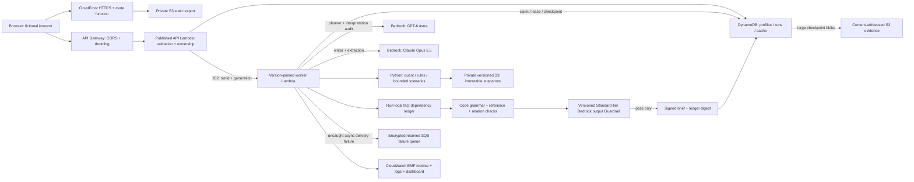

# Aplomb: evidence before conviction on AWS

The architecture serves a specific decision: explain why a hypothetical investment change fits or conflicts with a fictional investor's plan. Models propose and explain; Python calculates the numbers and enforces the rules. AWS runs the actual application, models, durable workflow and evidence storage.

## Choices a judge can inspect

| Choice | What it contributes | Proof |
|---|---|---|
| API and worker separation | HTTP returns a durable run identity without waiting for inference; polling survives refresh | `POST /v1/runs`, then poll the same run from a fresh connection |
| Conditional DynamoDB transactions | Session isolation, idempotency reservations, generation ownership, leases, cancellation fences and immutable terminal results | Duplicate a request/delivery; try another session; cancel an active run |
| Immutable snapshot pinning | Profile version, effective window, cutoff, dataset version and manifest digest are frozen at creation | Inspect private prepared context and the fact drawers; a changed manifest is rejected |
| Gated input receipts | Each time-series result cites a receipt hashing the actual aligned dates/levels, plus allocation assumptions where applicable | Inspect `Fact.inputs`, source references and `inputSha256` |
| Separate model roles | Planner proposes work; independent interpretation review checks the writer; neither can change rule calculations or execute trades | Actual model IDs and usage are persisted per step |
| Fail-closed signing | Numeric text must resolve through fact tokens; unresolved citations and unsupported claims are struck or signing fails | Audit report, dependency graph and ledger SHA-256 |
| Frozen Standard-tier Bedrock Guardrail | Blocks immediate trading instructions/profit promises; it does not certify numerical accuracy | Versioned `ApplyGuardrail` result in the brief's audit |
| Retained failure destination | An exhausted asynchronous platform failure has an inspectable destination rather than disappearing | SQS destination and queue alarm; application failures remain persisted in the run |
| Bounded compute | API/worker reserved concurrency, aggregate throttling, per-session quotas, wall-clock/inference/revision/scenario budgets | CDK template, repository watchdog and execution limits |
| CloudWatch operations | Distinguishes transport errors from durable workflow failures; shows actual token use and latency | `Aplomb-operations` dashboard and run-correlated EMF logs |
| Narrow execution IAM | Lambda cannot deploy; model permissions name exact inference profiles/destination models; S3 permissions name snapshot/evidence prefixes | Synthesized policies; no broad managed execution policy |

The architecture deliberately uses standard serverless orchestration with durable checkpoints rather than adding services merely to increase the count. There is no VPC/NAT infrastructure to operate for a workload using public AWS service endpoints, and the frontend has no server runtime.

## Demonstration sequence

1. Open Home and show the fictional persona and historical metrics from the pinned snapshot. Wait for the real analyst brief; open its execution timeline and an underlying fact.
2. In Decision Desk, test Robert with a substantial hypothetical TSLA allocation. Show deterministic conflicts and the evaluated smaller/alternative scenarios. Compare another persona without changing the calculation rules.
3. Explain the split between calculations and language: the model never supplies a volatility or overrides a rule threshold. Show the writer, independent reviewer, code audit and output-policy result.
4. Refresh during execution, then read the same run. Retry with the same idempotency key and show the same run ID. A duplicate worker delivery must leave the terminal run unchanged.
5. Show `Aplomb-operations`: invocations, latency, audited successes/failures, actual Bedrock tokens and the failure queue. Tie a persisted run ID to its worker log record.

## Honest boundaries

- A ledger digest provides integrity evidence; it is not a legal or asymmetric cryptographic signature.
- At-least-once delivery can repeat inference if a process dies after provider completion and before checkpointing. Cached model outputs and generation fences reduce repeated work; they do not make external model calls exactly once.
- Cancellation fences durable writes; a provider request already in flight may continue until its bounded timeout.
- The failure destination captures exhausted platform invocation failures. Handled workflow failures are recorded in DynamoDB and counted in custom metrics. The repository watchdog marks stuck runs failed when polled; no scheduled repair service is claimed.
- Optional capabilities are switched on per release only after their path passed live. As of release `1307604` (API and worker version 13), ten flags are on, including open-web research through AgentCore Browser, replay (`time_machine`), the world layers and the sabotage demo; the [release records](../infra/README.md) list each release's flags and live checks, and `/v1/meta` reports those of the running release. On-demand ticker publishing is currently local-only; no provider token is stored in the public frontend.
- Session IDs are browser-held bearer capabilities for fictional demo state, not authenticated accounts. No trading or money movement exists.
- Alarms and a dashboard are provisioned; no paging destination or operator acknowledgement workflow is claimed.
- Availability, provenance and numeric audits support explainability; they cannot remove data quality limitations, survivorship bias or model interpretation error.

Deployment IDs, hashes and observed live outcomes belong in `infra/evidence/`; tests alone are never presented as proof of a live AWS workflow.

The output policy was migrated after the Classic-tier policy falsely blocked a real historical brief. Frozen Standard-tier version 3 passed the exact prior output and blocked an explicit trading-profit promise. Its regional profile permissions follow the [AWS Guardrail profile policy](https://docs.aws.amazon.com/bedrock/latest/userguide/guardrail-profiles-permissions.html); no wildcard region or resource is granted.

Numeric API and per-run worker version routing are now implemented, with retained release-specific IAM and delivery configuration. Drain legacy unqualified work before the initial migration; retain referenced releases during later rollouts. The [earlier release evidence](../infra/evidence/aws-architecture-2026-11-14.json) predates this routing.

The full-stack follow-up release added numeric-version routing, retained release IAM/delivery configuration, stricter artifact inventory, cache validation and cache-aware token accounting; its [live evidence](../infra/evidence/full-architecture-audit-2026-11-14.json) also records that no transactional outbox or global admission control is implemented.
