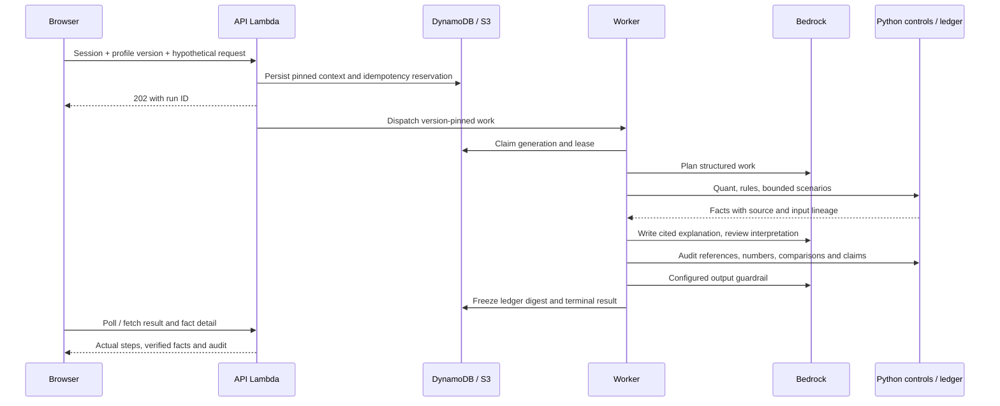

# Technical delivery note

This document describes implemented boundaries and links to executable evidence. Use the [acceptance report](acceptance.md) for current status and the [AWS architecture](../AWS-ARCHITECTURE.md) for deployment details. All scenarios concern fictional portfolios and historical simulations.

## Request to audited result

The role taxonomy separates planning, research, writing, interpretation audit, extraction and profile drafting; these do not imply six model calls on every request. Quant, rule verdicts, scenario bounds, reference validation and signing are deterministic components. The durable record carries actual actors, model IDs, durations, errors and usage. Missing model configuration returns unavailable rather than a fixture result.

The execution envelope allows at most two revise loops, one structural rewrite and a 180-second hard worker budget, with a 90-second target. Conditional ownership/generation fences prevent stale workers or cancellation races from overwriting terminal results. A crash after inference but before checkpointing can repeat a provider call; exactly-once inference is not claimed. Session IDs are bearer capabilities for demo state, not authenticated accounts.

## Methods and one traced figure

The starter dataset has 40,049 price rows and 31 assets. Portfolio returns use adjusted prices aligned to the 1,228-day TSX/US calendar intersection, yielding 1,227 returns. USD values convert to CAD using the most recent available USD/CAD rate, without future filling. Portfolio weights are constant across the historical simulation. Volatility uses sample daily standard deviation times the square root of 252; drawdown uses the peak-to-trough decline of cumulative returns. The API reports positive drawdown magnitude and signed stress returns.

Trace Robert +25 TSLA, pro-rata, from the request to the explanation:

1. Pin `snap-20261113-starter`, full window, CAD, as-of 2026-11-12 and the effective Robert profile version.
2. The previously unheld target becomes weight 0.25. Each other weight is multiplied by 0.75; XBB.TO changes from 0.30 to 0.225. Weights sum to one.
3. The datastore gate reads only visible adjusted-price/FX rows. Input receipts identify actual aligned observations and their digest. Quant computes weighted daily returns and historical volatility.
4. Multiplying daily sample standard deviation by `sqrt(252)` and 100 gives the API volatility, which rounds to **16.96%**. The independent [reference calculation](../../contracts/controls/controls.py) and [control table](../../contracts/controls.md) supply the oracle at ±0.005 percentage points.
5. The quant ledger records a `vol.annualized` fact with method, input fact IDs, currency, window, observation count, source/version and limitations. Rule checks refer to that fact and a separately recorded threshold fact. Fact IDs are assigned per run; there is no universal hard-coded ID for this number.
6. The writer uses a fact segment. The auditor resolves the ID in the same run, checks permitted displays and verifies lineage. The UI opens `/runs/{runId}/facts/{factId}` for the cited segment. The [composed run test](../../backend/tests/integration/test_run_composition.py) checks every numeric segment resolves. A fresh browser click-through remains required.

For existing targets, pro-rata redistribution excludes the target from the donor denominator. New-money size is expressed against the old value: weights divide by `1 + size/100`, while total value increases by that factor. Ordered donor funding depletes only nominated holdings and rejects insufficient donors. Grid boundaries stop before the first conflict; tension or missing evidence can remain. Goal searches screen at most eight assets and return at most three distinct candidates within the six-scenario ceiling. The historical minimum-variance frontier is illustrative.

## Trust and historical data

Source text cannot grant tool authority. Research evidence records publisher, URL, retrieval/publication times, document references and verification. Quote checks depend on stored passages and source ownership. Missing controversy coverage remains `nee`; financial checks do not substitute for it. Exposure to an event does not establish its financial impact. [Research tests](../../backend/tests/research/test_research.py) exercise captured transports and hostile content; this QA run makes no live source call.

Historical gates exclude future price rows and unavailable releases. A separate reveal computes later outcomes without changing the signed parent. Current-vintage macro limitations, survivorship and model knowledge remain visible. Adjusted prices are used as supplied; CNQ's adjustment anomaly is disclosed rather than silently corrected. Assumed risk thresholds, constant weights, sample dependence and no ETF constituent look-through constrain interpretation.

## Validation and release boundary

The [gate report](evidence/report.json) records environment, revision, commands, exits and log hashes. The integration gate covers generated contracts, lint, Python units/integration, web contract/logic tests, TypeScript, numeric references, links and infrastructure synthesis. The added HTTP probe checks primary personas and funding using real starter calculations without a model and publishes twenty-sample local latency distributions. The static gate loads nested routes without a Next.js server.

The optional [browser runner](../../tests/run_browser_smoke.py) serves a temporary starter-data API and static export with headless Chrome. Its [retained results](evidence/browser.json) cover all nine pages at three widths and actual deterministic Robert/Amira comparison. No model or fixture is supplied. Full signed-brief, accessibility and execution-refusal browser journeys remain pending.

The earlier AWS capture uses a sourced snapshot and another release; do not present its timings or numeric results as current starter controls. Pending work includes remaining browser journeys, current deployed-UI decision with correlated cloud evidence, production parser/cold-start measurements, recorded video and final submission hosting. See [demo instructions](demo.md) for the capture manifest and pre-shutdown checklist.
